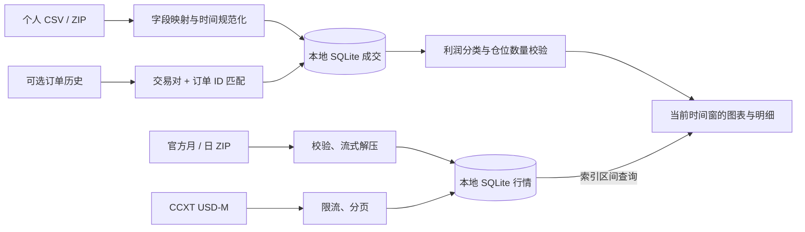

# Perp Recap 产品与技术设计

## 要解决的问题

交易者已从币安导出 U 本位成交历史，希望查看自己的实际操作在当时行情中的位置。文件可能时间混排、同秒多笔、跨多个币种、分片压缩，且缺少订单类型和持仓方向。产品必须在这些条件下仍可使用，并清楚区分原始事实与推导。

核心流程：导入并预览 → 选择仓位分析口径 → 按币种下载行情 → 定位成交并复盘。支持只提供交易历史，其他导出失败不阻塞核心流程。

## 页面设计

- **导入记录**：本地账户、成交 / 订单类型、CSV / ZIP、字段映射、时区来源、顺序诊断、错误行、重复统计。默认支持用户选择的利润分类规则。
- **仓位依据**：已实现利润分类、假设期初空仓、人工确认期初仓位。单向与双向分开；不确定性可见。
- **下载行情**：选择部分或全部币种，周期、交易前后缓冲、可选日期范围；官方月 / 日 ZIP 或 CCXT；已有归档载入、进度、缺口数量。
- **图表复盘**：币种、成交定位、时间窗口、前后翻页、K 线与成交量、精确成交价标记、来源及仓位说明、明细和导出。
- **全局显示时区**：固定 UTC 偏移，默认 0。导入偏移单独设置，不能改变历史 UTC 值。

## 分层

Python 模块独立于 Streamlit，方便未来替换图表界面。`importer.py` 只处理输入，`positions.py` 不访问网络，`market.py` 只访问公开行情，`store.py` 负责隔离账户及事务。

## 数据模型

| 表 | 主键 | 内容 |
| --- | --- | --- |
| fills | account + identity | UTC 成交时间、交易对、方向、精确价格与数量、手续费及资产、已实现利润、成交 ID / 订单 ID、原始订单类型与持仓方向 |
| orders | account + symbol + order_id | 可识别订单类型；不把订单数量当作成交数量 |
| contexts | account | 持仓模式、分析口径、各币种各方向的期初仓位 |
| candles | symbol + interval + time | 合约价格 OHLCV、计价成交量、笔数、主动买入量、来源 |

成交数值以十进制字符串保存，只在画图时转浮点。行情来源限定 U 本位同一种价格口径，未来添加标记价格时必须扩展数据主键，不能混入当前合约成交价缓存。

## 时间与排序

1. 表头显式时区优先，其次文件名 `UTC0` / `UTC+3`，否则提出默认 UTC 供确认。
2. 带时区的时间字符串尊重自身偏移；无时区字符串使用导入偏移；Unix 时间戳不重复套偏移。
3. 秒 / 毫秒 / 微秒统一为 UTC 毫秒。
4. 同币种按时间排序，再按数值成交 ID。原始文件行序不代表成交先后。
5. 同刻存在反向成交而缺少 ID，则不编造顺序。不同币种各自维护仓位。
6. 图表与成交在同一显示时区转换；CSV 的 UTC 原值仍可查看。

## 行情与内存预算

- **下载**：归档原包流式写磁盘，校验 SHA256，逐行解压，每批最多 1,000 根写 SQLite。CCXT 单次最多 499 根。
- **缓存**：使用 SQLite 复合主键的范围查询。完整范围用 SQL COUNT 检查，不读取全部 JSON。
- **图表**：先 COUNT，超过 8,000 根直接提示；只有通过限制后才加载该窗口。浏览器不持有全历史。
- **窗口导航**：日期 / 时间、前后按钮、定位成交按需查询。不把 Plotly 的本地拖动误称为无限历史加载。
- **错误**：网络失败保留已完成页；429 / 418 停止整个批次；不会忙重试到封禁。缺口展示，重试补未完整窗口。
- **归档整月**：完整月包可能多于用户选中的数天，额外数据保存在磁盘供后续读取。当前月按日包补齐，近期数据可用 CCXT。
- **成交导入限制**：首版导入和仓位计算仍受账户成交规模影响，明确限制上传文件大小；未来将其迁移至流式暂存和按币种增量状态机。

## 边界与验收

首版不下单，不保存交易密钥，不包含策略回测。订单类型缺失保持未知；Maker/Taker 不被转换成 Market/Limit。完整净收益需要私人资金费流水，不用公开资金费率代替实际扣款。

验收使用虚构交易 fixtures 与测试隔离数据库，覆盖中英文导入、ZIP 分片、时间偏移、同刻排序、重复与冲突、正反向加减仓、反手、缺失期初、双向模式、利润规则冲突、行情分页与缓存、流式入库。真实文件可本地验证，但不进入仓库、测试夹具或截图。
